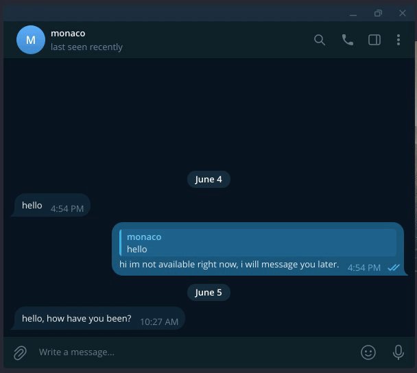

# mytg

A minimal Telegram userbot built on [Telethon](https://github.com/LonamiWebs/Telethon). Connects to your own account and runs pluggable behaviors, self-contained event handlers that react to incoming messages, commands, and other activity.

> **Note:** This is a userbot, not a bot. It runs under your personal Telegram account using the MTProto API.

---



---

## Behaviors

| Behavior | Trigger | What it does |
|---|---|---|
| `AutoReplyBehavior` | Incoming DM while offline | Sends a configurable away message, once per sender per hour |
| `TranslateBehavior` | `!tr <language>` (reply to a message) | Translates the replied message via Google Translate |
| `ExportMessagesBehavior` | `!export [limit]` (send to Saved Messages) | Exports your outgoing messages across all dialogs to `data/messages_export.jsonl` |

Behaviors are toggled in the `BEHAVIORS` list in `main.py`.

---

## Setup

**Prerequisites:** Python 3.11+, a Telegram account, and an app registered at [my.telegram.org/apps](https://my.telegram.org/apps).

```bash
git clone https://github.com/nucleardust/mytg
cd mytg
pip install -r requirements.txt
```

Create a `.env` file:

```env
API_ID=your_api_id
API_HASH=your_api_hash
SESSION_STRING=
```

**First run** — generates a session string:

```bash
python main.py
# Follow the prompts, then paste the printed SESSION_STRING into .env
```

**Normal run:**

```bash
python main.py
```

---

## Adding a behavior

1. Create `behaviors/my_thing.py` with a class extending `Behavior`.
2. Implement `register(self, client)` — attach `@client.on(...)` handlers inside.
3. Add one line to `BEHAVIORS` in `main.py`.

```python
# behaviors/my_thing.py
from telethon import TelegramClient, events
from .base import Behavior

class MyThingBehavior(Behavior):
    def register(self, client: TelegramClient) -> None:
        @client.on(events.NewMessage(incoming=True, func=lambda e: e.is_private))
        async def handler(event):
            ...
```

---

## Contributing

Contributions are welcome. To add a new behavior or improve an existing one:

1. Fork the repo and create a branch.
2. Follow the behavior pattern above — keep state as instance variables, use `incoming=True` to avoid reacting to your own messages, and add per-sender cooldowns to any auto-reply logic.
3. Open a pull request with a short description of what the behavior does and when it triggers.

For AI-assisted edits, see [`CLAUDE.md`](CLAUDE.md) — it has the full project context and architecture notes.

---

## License

MIT
